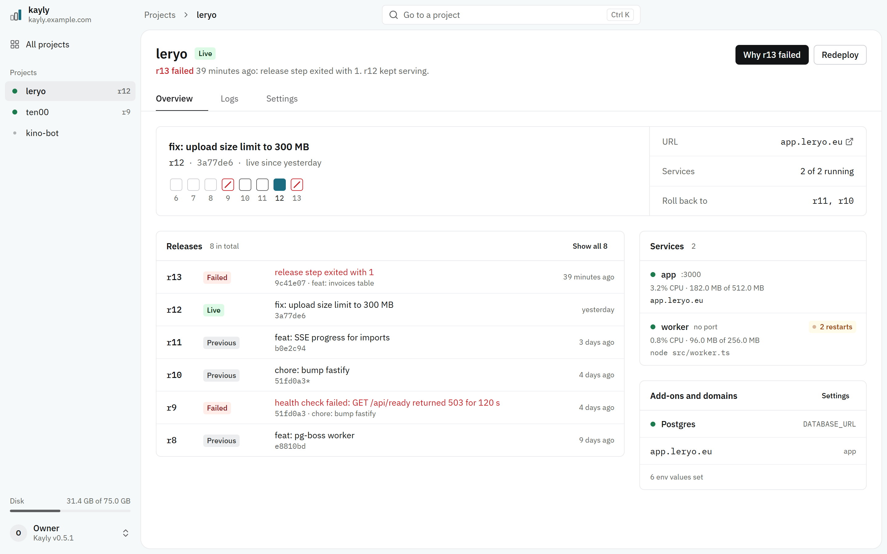
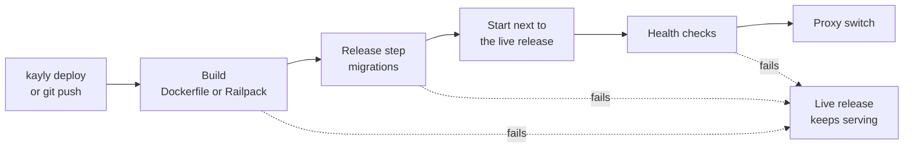

<div align="center">


# Kayly

**Deploy web apps, APIs, workers and Telegram bots to a server you own,<br>with the deploy model of a managed platform.**

[](https://github.com/kotlovyim-dev/kayly/actions/workflows/ci.yml)
[](https://github.com/kotlovyim-dev/kayly/releases)
[](go.mod)
[](LICENSE)

[Install](#quick-start) · [Documentation](docs/README.md) · [Architecture](ARCHITECTURE.md) · [Changelog](CHANGELOG.md)

</div>

https://github.com/user-attachments/assets/678a3c42-9029-40a1-998b-672421237f91

<picture>
  <source media="(prefers-color-scheme: dark)" srcset="docs/assets/ui-overview-dark.png">
  
</picture>

## Why Kayly

Managed platforms got the deploy model right: a release goes live only when it is healthy, a bad one rolls back in a click, and nobody edits a Compose file at 2 a.m. Kayly brings that model to a VPS you already pay for, as one Go binary next to Caddy.

- **A failed deploy changes nothing.** Build, release step (migrations) and health checks all run before traffic moves. If any of them fails, the live release keeps serving.
- **Zero-downtime switches.** The new release starts next to the old one and takes traffic only once it is healthy. An upgrade of Kayly itself drops no request either.
- **Instant rollback** to any of the last three releases. Releases are immutable, so a rollback never rebuilds.
- **Secrets per service.** A value reaches only the services you list. Generated secrets are created on the first deploy.
- **Data that outlives the server.** One-click Postgres and Redis, with backups encrypted to your own S3 bucket and a weekly restore drill that proves they work.
- **You hear about trouble.** Failed deploys, failed backups, restart loops, failing health checks and a filling disk reach your Telegram or a webhook.
- **Telegram bots and Mini Apps are first-class.** Kayly checks the token, sets the webhook with a generated secret, and keeps the menu button pointed at your app.
- **Built for agents too.** The CLI, the HTTP API and an MCP server share one set of scoped, audited tokens, so a coding agent can deploy, read logs and roll back, and nothing more.
- **Small.** About 40 MB of RAM for the whole control plane.

## Quick start

**1. Install** on a fresh Ubuntu 22.04+ or Debian 12+ server (amd64 or arm64) with ports 80 and 443 open:

```sh
curl -fsSL https://raw.githubusercontent.com/kotlovyim-dev/kayly/main/install.sh | sudo sh
```

The installer brings Docker (if missing) and Railpack, installs Kayly only after checking the release's signature, starts the `kayly` systemd service and prints a login command.

**2. Sign in** from your laptop (Linux, macOS or Windows) with the command the installer printed. The CLI comes from npm (or as a binary from [Releases](https://github.com/kotlovyim-dev/kayly/releases)):

```sh
npm install -g kayly           # or prefix each command with npx: npx kayly login …
kayly login https://kayly.203-0-113-7.sslip.io kayly_…
```

**3. Deploy** from your app's directory:

```sh
kayly deploy
```

No Dockerfile? Kayly builds with [Railpack](https://github.com/railwayapp/railpack). Every service with a port is live at `https://<service>.<project>.<ip>.sslip.io` with a real certificate, before you set up any DNS. The web UI takes the same token.

## Describe your app

`kayly.toml` sits at the root of the repository:

```toml
[release]                       # optional: runs before each release; failure stops the deploy
command = "node migrate.js"

[services.web]
port = 3000
health = "/health"
memory = "512m"                 # optional limits, so one runaway process cannot starve the rest

[services.worker]
command = "node worker.js"

[env]
SESSION_SECRET = { generate = "base64:32" }   # created on the first deploy
API_KEY        = {}                           # set with `kayly env set`
ADMIN_TOKEN    = { to = ["release"] }         # only the release step sees it
PUBLIC_URL     = { template = "${web.url}" }
```

Every key is documented in the [`kayly.toml` reference](docs/reference/kayly-toml.md).

## Day to day

```sh
kayly env set API_KEY=...                  # Kayly says which values are missing
kayly domains add app.example.com web      # HTTPS is issued automatically
kayly logs web -f
kayly releases                             # with the git commit of each; `kayly releases log r12` has its output
kayly rollback r12
kayly status                               # disk and memory; state, restarts, CPU and memory per service
sudo kayly upgrade                         # signed, backed up first, apps keep serving
```

Push to deploy: a project can follow a git repository over SSH with a deploy key, and a GitHub push deploys it. See [Deploy](docs/deploy.md).

## Telegram bots and Mini Apps

```toml
[services.bot.telegram]
token = "BOT_TOKEN"          # the [env] key that holds the token
mode = "webhook"             # or "polling"
path = "/telegram"
menu_button = { text = "Open", url = "${web.url}" }   # optional: opens a Mini App
```

Kayly checks the token before a release starts, sets the webhook (with a secret it generates) or clears it for polling, and keeps the menu button pointed at your app. Examples: [a bot](examples/telegram-bot) and [a Mini App](examples/telegram-mini-app).

## Alerts and backups

```sh
echo "$BOT_TOKEN" | sudo kayly notify telegram <chat-id>                     # or: kayly notify webhook <url>
kayly addons add postgres                                                     # backed up daily and before every release step
echo "$S3_SECRET" | sudo kayly backups setup <endpoint> <bucket> <access-key> # prints the recovery key once
kayly backups restore latest -remote                                          # or -from <project>, to rehearse elsewhere
```

Lost the server? On a new one, `kayly restore -endpoint … -recovery-key …` brings back Kayly's state and the newest backups. See [Add-ons and backups](docs/backups.md).

## Agents and MCP

The daemon serves the [Model Context Protocol](https://modelcontextprotocol.io) at `/mcp`. Give an agent a token that can deploy one project and nothing else:

```sh
sudo kayly token create claude -scope deploy -p my-app -expires-days 30
claude mcp add --transport http kayly https://kayly.<host>/mcp --header "Authorization: Bearer <token>"
```

Every call is checked against the token's scope and project, and written to the audit log. Tools are listed in the [MCP reference](docs/reference/mcp.md).

## How it works



One Go binary plays every role: the daemon (API, embedded web UI, MCP, deploy pipeline, reconciler, backup scheduler) and the CLI. Caddy runs as a separate long-lived container for TLS, routing, WebSockets and SSE, and apps run as Docker containers labelled with their project, release and service. SQLite holds the desired state and Docker the actual state, and a reconciler keeps them in line. That is why Kayly can crash or upgrade mid-deploy without dropping traffic. CI proves it by killing the real daemon at every pipeline step.

The invariants, data model and pipeline are in [ARCHITECTURE.md](ARCHITECTURE.md).

## How it compares

Kayly sits between two kinds of tool. **Kamal** gives zero-downtime deploys from a laptop, but no UI, databases or backups. **Coolify** gives a UI and hundreds of one-click services, but needs about 2 GB of RAM, and its Compose deploys do not switch without downtime. Kayly is for people who want the managed-platform deploy model, a database, backups and alerts on one small server, with Telegram bots treated as a real app type. The full comparison, including Railway, Render and Vercel, is in [RESEARCH.md](RESEARCH.md).

## Status

**v0.5.1 is the latest release.** It covers deploys, rollbacks, crash recovery, env values, domains, one-click Postgres and Redis, local and off-site backups with a weekly drill, alerts, git push deploys, scoped tokens with an audit log, an MCP server, Telegram bots and Mini Apps, signed releases with `kayly upgrade`, and the [documentation](docs/README.md).

**1.0** freezes `kayly.toml`, `/api/v1`, the CLI and the MCP tools under semver ([what 1.x promises](docs/compatibility.md)). It ships when the exit criteria hold on real servers:

- two production apps run 30 days with no manual fix;
- one is restored from S3 onto a clean VPS;
- v0.5 upgrades to v1.0 with zero failed requests;
- a fresh VPS reaches a live URL in under 5 minutes with only this README.

The [roadmap](ARCHITECTURE.md#12-milestones) has the milestones. Multiple servers, teams, autoscaling and preview deploys are deliberately out of scope for 1.0.

## Documentation

| Guides | Reference |
|---|---|
| [Install](docs/install.md) | [`kayly.toml`](docs/reference/kayly-toml.md) |
| [Deploy](docs/deploy.md) | [CLI](docs/reference/cli.md) |
| [Domains and HTTPS](docs/domains.md) | [HTTP API](docs/reference/api.md) |
| [Add-ons and backups](docs/backups.md) | [MCP tools](docs/reference/mcp.md) |
| [Telegram bots and Mini Apps](docs/bots.md) | [Compatibility](docs/compatibility.md) |
| [Troubleshooting](docs/troubleshooting.md) | [Changelog](CHANGELOG.md) |
| [Security model](docs/security.md) | [Architecture](ARCHITECTURE.md) |

## Develop

```sh
go test -race ./...                                               # unit tests, including the pipeline against a fake runtime
KAYLY_DOCKER_TESTS=1 go test ./internal/docker ./internal/build   # against a real Docker daemon
sudo bash test/e2e/e2e.sh ./kayly                                 # a whole server, on a disposable host (CI runs it)
cd web && npm test && npm run dev:mock                            # the UI's tests, and the UI on sample data
```

Every behaviour change ships with a test, and pipeline changes are tested against the fake runtime with a crash at each step. Issues and pull requests are welcome. For anything larger than a fix, open an issue first, and read [ARCHITECTURE.md](ARCHITECTURE.md): a change that contradicts it updates the document in the same pull request.

## License

[AGPL-3.0](LICENSE). Run it, change it and host it. If you offer a modified Kayly to others over a network, share your changes under the same license.
